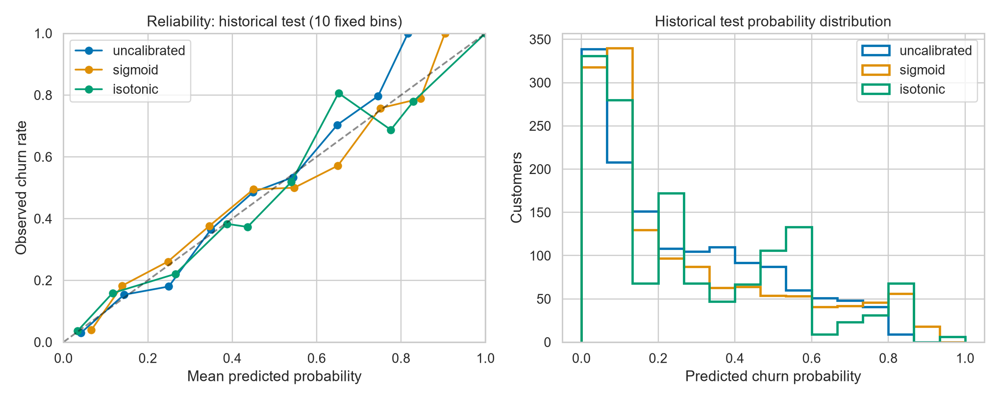
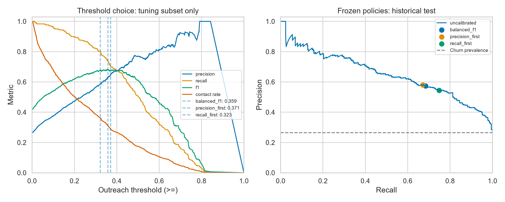

# Weekly assignment: model calibration and threshold tuning

Prepared for Hrishikesh Hete, week ending November 20, 2026.

Recommend **uncalibrated probabilities with the balanced-F1 threshold 0.358833** for a historical outreach pilot design. On the existing 1,409-customer test subset this flags 446 customers, finds 256 of 374 churners, and yields **57.4% precision / 68.4% recall / 0.624 F1**. This is a candidate policy for independent validation, not a deployed campaign.

## Precision and recall tradeoff

| Policy | Threshold | Precision | Recall | F1 | Contacts | TP | FP | FN | TN |
|---|---:|---:|---:|---:|---:|---:|---:|---:|---:|
| uncalibrated_050 | 0.500000 | 66.7% | 44.9% | 0.537 | 252 | 168 | 84 | 206 | 951 |
| selected_050 | 0.500000 | 66.7% | 44.9% | 0.537 | 252 | 168 | 84 | 206 | 951 |
| balanced_f1 | 0.358833 | 57.4% | 68.4% | 0.624 | 446 | 256 | 190 | 118 | 845 |
| precision_first | 0.371446 | 58.0% | 67.1% | 0.622 | 433 | 251 | 182 | 123 | 853 |
| recall_first | 0.322665 | 54.5% | 74.9% | 0.631 | 514 | 280 | 234 | 94 | 801 |

Precision-first reaches 58.0% test precision against its 65% tuning target. Recall-first reaches 74.9% test recall against its 80% tuning target. These targets are tuning constraints, not guaranteed minimum performance on new data.

Compared with the same refitted uncalibrated model at 0.50, the balanced policy changes contacts by +194, true positives by +88, false positives by +106, and missed churners by -88. Both rows use identical base-fit data; they are not comparisons against the legacy model trained on all 5,634 training records. `selected_050` isolates calibration at the default threshold; `balanced_f1` then shows the threshold change.

A contact is a flagged historical record. Precision measures the share of flagged customers who churned; recall measures the share of observed churners flagged. Neither is an intervention success or save rate. Approximate 95% Wilson intervals for the balanced policy are precision 52.8%–61.9% and recall 63.6%–73.0%; they describe binomial sampling uncertainty only, not model selection, distribution drift, or prior data exposure.

## Calibration comparison

| Method | Calibration OOF log loss | Brier | ECE (10 bins) | Selected |
|---|---:|---:|---:|---|
| uncalibrated | 0.41649 | 0.13695 | 0.02358 | True |
| sigmoid | 0.42744 | 0.13908 | 0.03765 | False |
| isotonic | 0.47864 | 0.13938 | 0.02970 | False |

Neither sigmoid nor isotonic improved calibration-subset OOF log loss; retain the uncalibrated model and tune its outreach threshold. Calibration was evaluated rather than assumed beneficial.

Choose the method using pooled five-fold out-of-fold **log loss on calibration records only**; lower is better. Brier score is the first tie-breaker. The uncalibrated option remains eligible so calibration is not assumed to improve results. Calibration CV estimates become selection statistics, not an independent final evaluation. Isotonic is flexible and may overfit with only about 900 calibration-fit observations per fold; extreme probabilities are penalized by log loss. ECE uses ten fixed equal-width bins, includes empty bins with zero weight, and is a descriptive, bin-sensitive measure. Brier and log loss reflect discrimination as well as reliability.

| Method | Historical test log loss | Brier | ECE | ROC-AUC | AP |
|---|---:|---:|---:|---:|---:|
| uncalibrated | 0.42131 | 0.13740 | 0.02575 | 0.8414 | 0.6518 |
| sigmoid | 0.42682 | 0.13798 | 0.03418 | 0.8414 | 0.6518 |
| isotonic | 0.46789 | 0.13842 | 0.02883 | 0.8394 | 0.6207 |

Historical test metrics above are reported after the policy was frozen. Differences here do not alter the chosen method or thresholds. Calibration need not improve every metric; isotonic can introduce ranking ties. Threshold tuning changes binary decisions, not the underlying probabilities or probability metrics.





## Reproducible design and leakage controls

Split counts: base_fit: 3,380 (897 churners); calibration: 1,127 (299 churners); threshold_tuning: 1,127 (299 churners); historical_test: 1,409 (374 churners).

Preserve the original test membership. Stratify the original training set 60/20/20 into base fitting, calibration, and threshold tuning with seeds 20261120 and 20261121. Clone the existing random_forest configuration, discarding every fitted tree and preprocessing statistic, then refit on base-fit records only. Fit imputation and encoding inside that pipeline; exclude customerID and Churn. No globally processed feature exports are used.

Wrap the fitted base pipeline in FrozenEstimator. For each of five stratified calibration folds (seed 20261122), fit sigmoid and isotonic calibrators on the other four folds and predict the omitted fold. Base fitting and calibration never overlap. After method selection, fit each calibrator on all calibration records for diagnostic comparison; export the selected method with its fitted preprocessing and base model. Threshold-tuning records enter neither the base fit nor any calibrator fit.

On the threshold subset, enumerate every distinct score plus 0 and 1 using the exact rule **probability >= threshold**. Maximize F1, the harmonic mean of precision and recall; ties prefer higher precision then higher threshold. This assumes equal precision/recall emphasis, not equal financial costs. Precision-first maximizes recall subject to tuning precision >= 65%; recall-first maximizes precision subject to tuning recall >= 80%. Ties for alternatives prefer F1 then higher threshold. Infeasible alternatives are omitted. Targets are illustrative and can fail on the test set or future customers. Keep full-precision thresholds in policy.json; displayed rounded values must not replace them. No final refit follows threshold selection because it would change the score scale.

## Operational handoff and limitations

Use `models/calibration/outreach_model.joblib` and `models/calibration/policy.json` together. The saved method may be uncalibrated if it wins the selection. Require matching artifact SHA-256 and compatible dependencies. Input is the original 19 predictor columns; cast SeniorCitizen to string. Scores above the threshold identify candidates for review, not automatic offers. Current eligibility, opt-outs, contact capacity and recent service history must come from a current customer feed. Rank eligible candidates by probability within a capacity limit; any capacity-based policy needs separate validation.

Use a randomized pilot to measure incremental retention, offer costs and net value. Track precision, recall, contacts, missed churners, calibration and cohort performance when mature outcomes arrive. No cost-optimal threshold or claimed revenue savings is supported by this dataset. There is no validated future prediction horizon. Service subscriptions are available; actual usage and complaints are absent and must not be inferred from subscription flags.

Historical family/hyperparameters were selected on all original training records, including records now reserved for calibration/tuning. The new fits and decisions avoid direct role leakage, but this does not undo earlier selection. The test subset has also appeared in prior EDA and evaluation. These are exploratory results; a new random split cannot make previously examined data pristine. Obtain fresh independent or later-period outcomes before production claims. The existing Power BI historical dashboard and retention queue still use their documented legacy scores and illustrative thresholds; this analysis supplies a separate validated handoff in `power_bi_handoff.md`.

## Deliverables and rerun

Run from the repository root with the pinned model environment:

```powershell
.\.venv\Scripts\python.exe scripts/calibrate_thresholds.py
.\.venv\Scripts\python.exe scripts/verify_calibration.py
```

Install `requirements-models-lock.txt` to reproduce the existing environment. Outputs: method-selection metrics and fold predictions; role/fold manifest; full tuning sweep; tuning and test policy metrics; probability metrics; reliability bins; customer evaluation predictions; two figures; metadata with source and model hashes; paired model/policy artifacts; Power BI handoff; and executable SQL reconciliation. All evaluation rows retain actual labels for analysis and are not a live outreach list. Verification is recorded in `verification.md`.

Method references: [scikit-learn probability calibration](https://scikit-learn.org/stable/modules/calibration.html) and [CalibratedClassifierCV / FrozenEstimator](https://scikit-learn.org/stable/modules/generated/sklearn.calibration.CalibratedClassifierCV.html). The latter requires the caller to keep fitting and calibration data disjoint.
