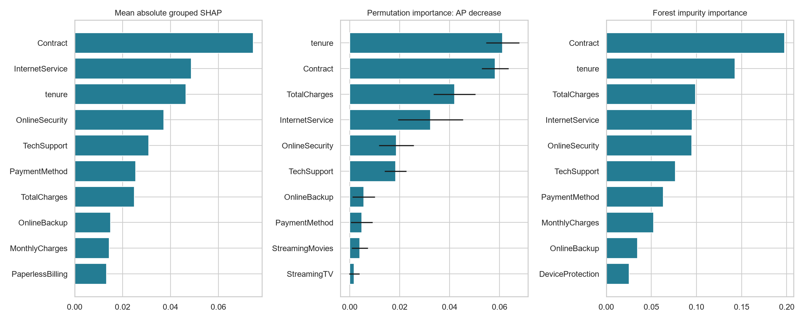
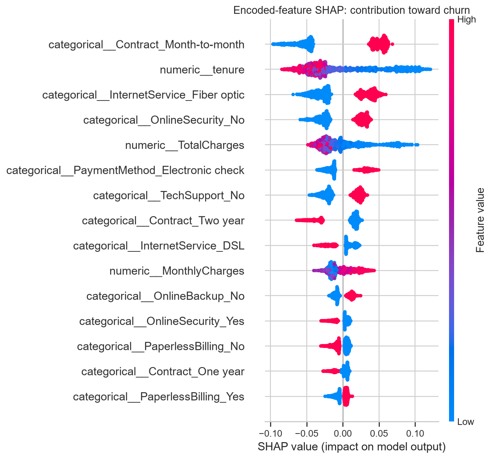
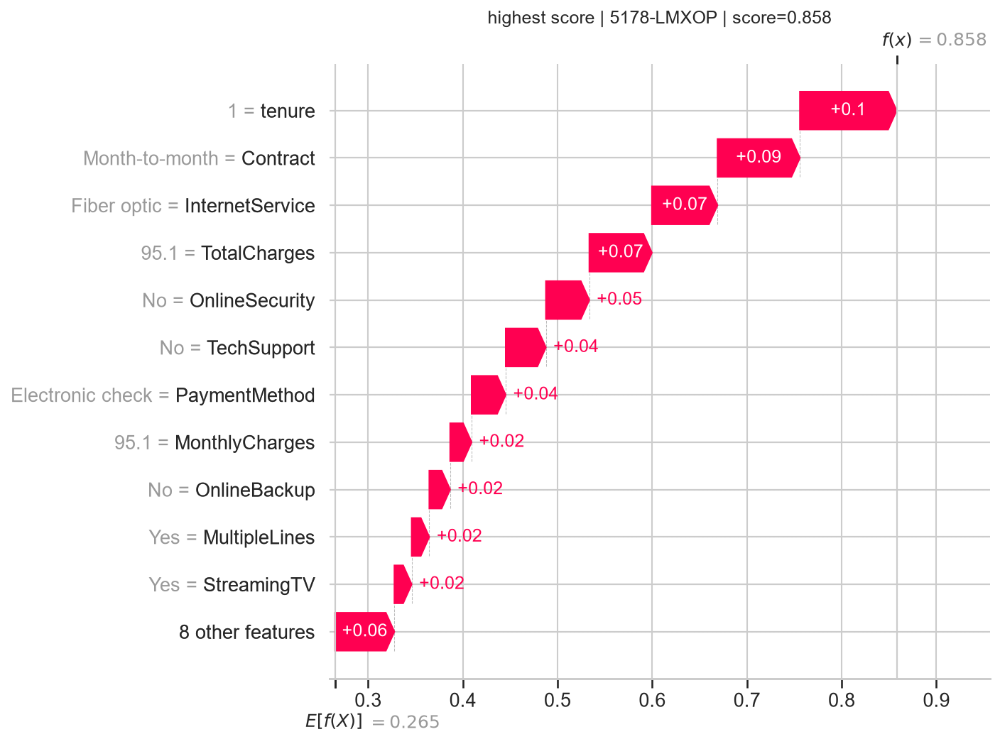
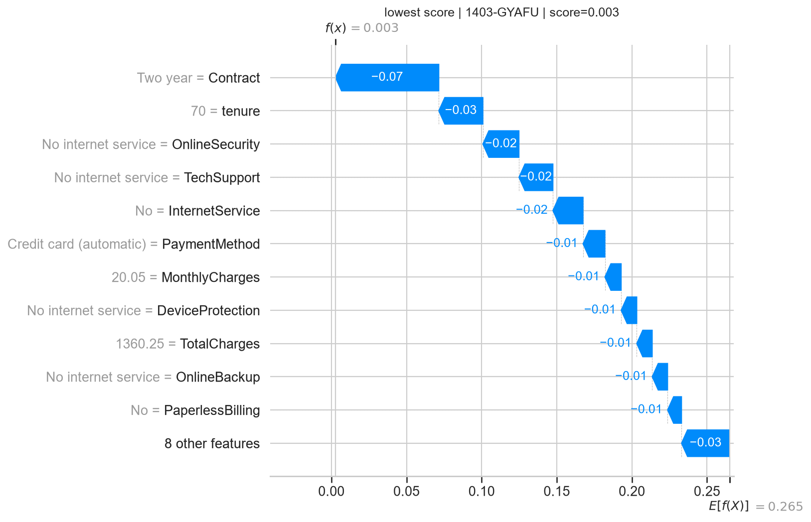
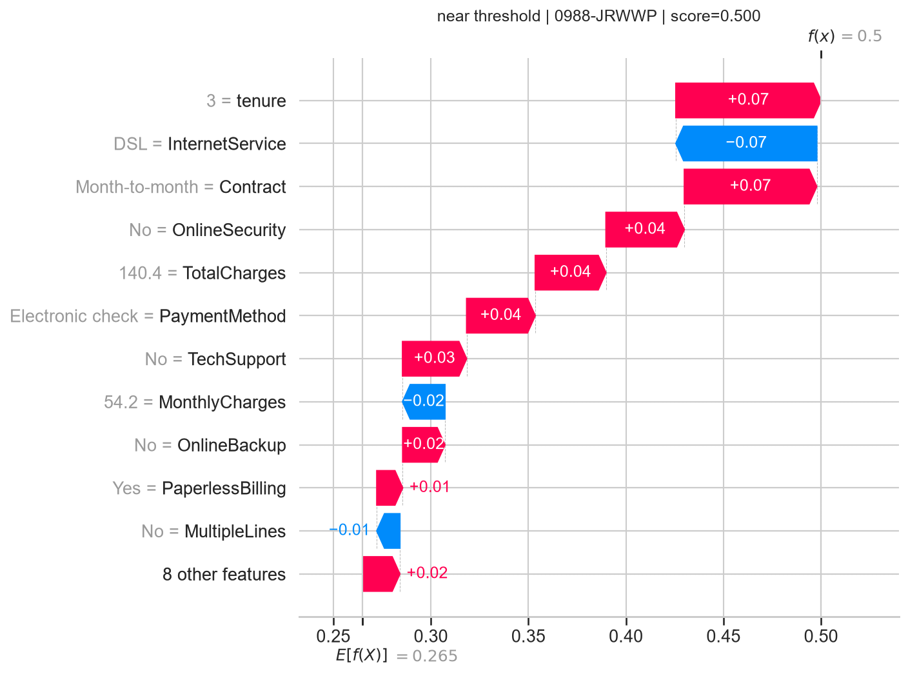

# Feature importance and SHAP: churn model drivers

Explained the previously selected **Random Forest**, unchanged, for all **1,409 evaluation customers**. Highest mean absolute grouped SHAP drivers: **Contract, InternetService, tenure, OnlineSecurity, TechSupport**.

## Global results

| Feature | Mean absolute grouped SHAP | Mean AP decrease | Permutation SD |
|---|---:|---:|---:|
| Contract | 0.0745 | 0.0583 | 0.0054 |
| InternetService | 0.0487 | 0.0323 | 0.0130 |
| tenure | 0.0465 | 0.0612 | 0.0067 |
| OnlineSecurity | 0.0373 | 0.0187 | 0.0070 |
| TechSupport | 0.0310 | 0.0183 | 0.0043 |
| PaymentMethod | 0.0255 | 0.0048 | 0.0043 |
| TotalCharges | 0.0249 | 0.0419 | 0.0084 |
| OnlineBackup | 0.0150 | 0.0056 | 0.0045 |
| MonthlyCharges | 0.0145 | 0.0004 | 0.0067 |
| PaperlessBilling | 0.0133 | 0.0016 | 0.0074 |

SHAP magnitudes are in probability units: 0.01 equals one percentage point of model score. Positive signed SHAP pushes toward churn; negative pushes away. The global table reports mean absolute contributions and therefore does not itself indicate direction.

## Direction of contributions

- **Contract**: `Month-to-month` has mean contribution +0.0750; `Two year` has -0.0895. These are group averages, not rules applying to every customer.
- **InternetService**: `Fiber optic` has mean contribution +0.0553; `DSL` has -0.0518. These are group averages, not rules applying to every customer.
- **tenure**: `(-0.001, 8.0]` has mean contribution +0.0774; `(55.0, 72.0]` has -0.0473. These are group averages, not rules applying to every customer.
- **OnlineSecurity**: `No` has mean contribution +0.0381; `Yes` has -0.0399. These are group averages, not rules applying to every customer.
- **TechSupport**: `No` has mean contribution +0.0310; `No internet service` has -0.0313. These are group averages, not rules applying to every customer.

Numeric groups are evaluation-set quartiles, used only to summarize explanations. Exact group sizes and signed averages are in `driver_direction.csv`.

The beeswarm shows encoded columns. Red/blue denotes high/low transformed feature values, not actual churn labels. Numeric values were standardized by the saved pipeline; one-hot values are 0/1. A missing one-hot category may itself contribute to a prediction.

## Individual predictions

The training-path reference probability is **0.2651**. Base plus all contributions reconstructs each churn score; maximum absolute error was **1.33e-15**. Three examples were selected deterministically by highest score, lowest score, and closest to 0.50, without using correctness.

Waterfalls aggregate dummy contributions into their original features. `local_explanations.csv` contains every contribution and observed value for these cases. Predictions are uncalibrated model estimates, not proven individual probabilities of future churn.

## Method and validation

Loaded the existing pipeline, raw records and split manifest; no model training, selection, or threshold changes. Confirmed predictions match the prior export. Tree SHAP uses `tree_path_dependent` and `model_output='raw'`; for this scikit-learn forest raw output is class probability, verified against `predict_proba`. The reference uses the fitted trees' training path counts, not a new test-derived background. See [official TreeExplainer documentation](https://shap.readthedocs.io/en/latest/generated/shap.TreeExplainer.html).

For categorical features, signed encoded SHAP contributions are summed within each customer before taking the mean absolute value. This preserves local additivity; it is an aggregation of encoded-feature attributions, not a recomputed coalition/group Shapley game. Mapping is exported explicitly. Impurity importance sums encoded columns. Permutation importance shuffles each original column through the complete pipeline, preserving valid one-hot combinations, and measures mean decrease in average precision over 10 seeded repeats. Repeat SD reflects permutation variability, not a population confidence interval. Negative importance is retained.

## Interpretation and limits

Importance measures answer different questions. Impurity importance can favor features with many split opportunities. Correlated tenure, charges, contracts and service indicators may share or mask importance. Shuffling can create unrealistic combinations across correlated columns; SHAP dependence assumptions also affect attribution. Do not interpret a ranking disagreement as a bug or a zero score as proof a variable is irrelevant.

These explain **model decisions, not causal drivers of actual churn**. The prior EDA included the evaluation partition; this remains exploratory analysis, not independent confirmation. Demographic associations must not be used to justify differential treatment. No direct complaint records or detailed consumption telemetry exist in this dataset.

Use the service, contract, tenure and billing patterns as hypotheses for customer research and controlled retention experiments. Inspect individual explanations before assuming a global driver applies to a particular customer; changing a feature does not guarantee a lower real-world churn rate. No outreach or deployment was performed.

## Reproduce and deliverables

Install `requirements-explainability-lock.txt` in a compatible Python environment, then run `python scripts/explain_model.py` and `python scripts/verify_explanations.py`. Outputs include global tables, encoded and grouped customer-level SHAP values, 10-repeat permutation results, driver directions, five charts, local examples, and provenance metadata. `shap_by_customer.csv` joins to `explanation_predictions.csv` on customerID for Power BI exploration; signed contributions must not be displayed as causal effects.
