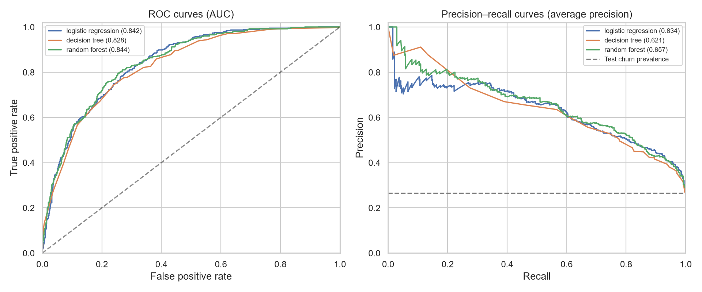
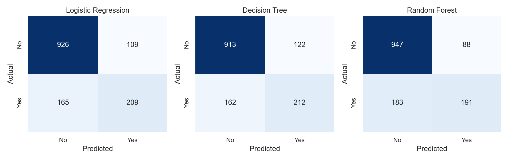

# Churn model training and evaluation

Trained Logistic Regression, Decision Tree, and Random Forest with a majority-class baseline. Selected **random forest** using training-only five-fold mean average precision. The evaluation split contains 1,409 records (374 churners); training contains 5,634.

## Comparison

| Model | CV average precision ± fold SD | Test ROC-AUC | Test AP | Precision | Recall | F1 | Accuracy |
|---|---:|---:|---:|---:|---:|---:|---:|
| logistic_regression | 0.661 ± 0.019 | 0.842 | 0.634 | 0.657 | 0.559 | 0.604 | 0.806 |
| decision_tree | 0.616 ± 0.023 | 0.828 | 0.621 | 0.635 | 0.567 | 0.599 | 0.798 |
| random_forest | 0.664 ± 0.019 | 0.844 | 0.657 | 0.685 | 0.511 | 0.585 | 0.808 |
| majority_baseline | N/A | 0.500 | 0.265 | 0.000 | 0.000 | 0.000 | 0.735 |

AP means average precision, a summary of the precision–recall relationship, not trapezoidal PR-AUC. Fold SD describes variation across folds and is not a confidence interval. Classification metrics use the predeclared 0.50 threshold. Full metrics include balanced accuracy, Brier score, and confusion counts in `test_metrics.csv`.

## Method

Used the original raw CSV and existing split manifest. customerID is excluded. Missing TotalCharges is median-imputed within each training fold; numeric predictors are standardized and categorical predictors one-hot encoded within the same pipeline. SeniorCitizen is categorical. Unknown categories are ignored at transformation. No globally imputed or encoded exports are used to train models.

Each candidate uses five stratified folds, shuffled with seed 42. Grid searches compare logistic C and class weighting, tree depth and leaf size, and forest depth and leaf size (200 trees). Exact grids and all fold scores are in the script and CV CSVs. Each winning pipeline is refitted on the training partition only. Model-family selection uses CV AP, never test ranking. No threshold tuning or oversampling is performed.

## Interpretation

At threshold 0.50 the selected model identifies 191 churners, misses 183, and flags 88 retained customers. These tradeoffs matter more for retention outreach than accuracy alone. Before deployment, choose a threshold using validation data and actual contact costs, retention success, and customer value; this assignment does not assume those quantities. Scores are uncalibrated estimates and should not be presented as validated individual risk probabilities.

## Evaluation limitation

The existing test partition was included in prior full-dataset descriptive EDA. It is excluded from fitting and grid selection here, but is **not a pristine independent confirmation set**. These results are an exploratory benchmark. Changing the random split would not undo prior exposure; use fresh independent or later-period data before claiming production generalization. No timestamps support temporal validation, and no direct complaint or detailed usage features exist in the source.

## Deliverables and verification

- `scripts/train_models.py`: reproducible training and evaluation.
- `models/*.joblib`: three fitted preprocessing-and-model pipelines. Load only trusted artifacts, using compatible versions recorded in metadata.
- `test_predictions.csv`: evaluation customer IDs, actual labels, scores, and 0.50-threshold predictions for each model and baseline. These are evaluation outputs, not a live outreach list.
- `metadata.json`: selected model, parameters, versions, source hash, and split counts.
- Separate CV tables, metrics, and two evaluation figures.

Verified disjoint customer IDs and complete split coverage, and reloaded each saved pipeline to confirm identical probabilities. Run `python scripts/verify_models.py` to independently recalculate every reported metric from the prediction export. Power BI can import `test_predictions.csv` linked on customerID, but must label its scope as the evaluation subset; it is not the full customer base.
