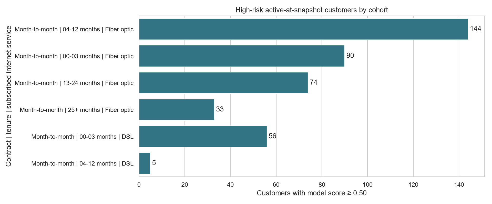

# Targeted retention strategy

Prepared November 4, 2026. This is a historical planning deliverable, not an executed customer campaign.

## Decision

Prioritize service and onboarding reviews for short-tenure, month-to-month customers, then test optional loyalty offers for established customers. Do not apply blanket discounts or assume that switching contracts causes retention.

The saved Random Forest flags **402 of 5,174 active-at-snapshot customers (7.77%)** at score >= 0.50. All 402 have month-to-month contracts; **295 (73.38%) have tenure <= 12 months**, and **341 (84.83%) subscribe to fiber optic internet**. Their monthly charges total **31,054.15 source currency units (CU)**. Score-weighted exposure is **18,657.19 CU** within this high-risk subset, distinct from the dashboard's 67,388.05 CU across all active records. Neither figure is a forecast of avoidable loss.

## Cohort priorities

The table orders mutually exclusive cohorts by score-weighted charge exposure, a review-capacity heuristic rather than estimated treatment benefit. Every high-risk customer appears once.

| Contract | Tenure | Internet subscription | High-risk customers | All active in cohort | Monthly charges of high-risk group (CU) | Primary play |
|---|---|---|---:|---:|---:|---|
| Month-to-month | 4–12 months | Fiber optic | 144 | 172 | 11,816.45 | R2 Service and plan-fit review |
| Month-to-month | 0–3 months | Fiber optic | 90 | 101 | 7,044.50 | R1 Onboarding and first-bill review |
| Month-to-month | 13–24 months | Fiber optic | 74 | 210 | 6,570.65 | R3 Loyalty and optional contract review |
| Month-to-month | 25+ months | Fiber optic | 33 | 483 | 3,084.05 | R3 Loyalty and optional contract review |
| Month-to-month | 0–3 months | DSL | 56 | 166 | 2,368.20 | R1 Onboarding and first-bill review |
| Month-to-month | 4–12 months | DSL | 5 | 231 | 170.30 | R2 Service and plan-fit review |

No annual-contract or no-internet customer crosses the current threshold. This does not establish zero churn risk in those populations. Maintain ordinary renewal and service support, and monitor them when scoring current data. The five-customer DSL cohort is descriptive only; do not infer a distinct treatment effect from it.

## Retention playbook

These actions are proposed experiments. Times below are pilot operating targets measured from a new, verified risk flag; they are not historical events inferred from Kaggle.

| Play and eligible population | Proposed treatment | Owner and timing | Offer rule and follow-up |
|---|---|---|---|
| R1: tenure 0–3 months; 146 customers | Guided activation/Wi-Fi setup check, first-bill explanation, and confirmation that promised services work | Onboarding team; review within 2 business days | Resolve a verified issue first. Use a policy-approved service credit only for a confirmed failure. Check resolution after 7 days. |
| R2: tenure 4–12 months; 149 customers | Ask about reliability and plan value; inspect actual speed/outage and consumption records; propose a needs-based plan review | Service care; review within 3 business days | Right-size only with evidence and customer agreement. Test a bounded support trial if useful; disclose expiry and do not auto-enroll. Follow up after 14 days. |
| R3: tenure >12 months and month-to-month; 107 customers | Review loyalty value, current bill and unresolved service issues; offer an optional annual-plan comparison | Retention specialist; review within 5 business days | Explain total cost and cancellation terms; retain a month-to-month option. Test an approved limited offer only after service issues are addressed. Follow up after 30 days. |
| R4: tenure >12 months on an annual contract; currently 0 customers | Relationship review and renewal assistance when future scoring identifies eligible records | Account care; review before a verified renewal date | Collect renewal date; tenure alone cannot identify it. No early-renewal assumption or automatic contract extension. |

Each customer gets one primary play. Additional service indicators modify the conversation rather than create overlapping campaigns:

- **374/402 lack a TechSupport subscription (93.03%)**: offer a guided diagnostic if appropriate. This field does not record service complaints, poor support, or inability to get basic assistance.
- **385/402 lack OnlineSecurity (95.77%)**: ask whether help understanding existing protection is wanted; absence is not evidence of a security incident. Avoid mandatory add-on upselling.
- **149 subscribe to StreamingTV and 149 to StreamingMovies**: use actual consumption to review bundle fit. These groups may overlap and must not be added together. Subscription is not usage volume.
- **293 use electronic check (72.89%)**: explain charges and payment choices if requested. Do not infer payment failure or force auto-pay.
- For fiber subscribers, check measured speed, outages and tickets before diagnosing a technical problem. No such measurements exist in the current source.

## Evidence and limits

The previous [EDA](../eda/findings.md) found 42.71% observed historical churn for month-to-month contracts and 47.44% for tenure 0–12 months. [SHAP analysis](../explainability/findings.md) ranks contract, internet service, tenure, security and support subscriptions among major model drivers. These support investigation of the proposed segments, not causal claims about the actions.

`cohort_priorities.csv` contains both high-risk share among active records and historical churn rate among **all** source records in the same cohort. They use different denominators and must not be labeled interchangeably. The historical churn label has no validated future prediction window.

Scores were produced October 29, 2026 from a historical Kaggle snapshot. Of the 402 candidates, **314 are training records and 88 are held-out test records**. The model scores are uncalibrated; the queue is not independent performance evidence, an uplift estimate, or a current customer contact list. Demographic fields are not used to assign plays. Existing observational/model biases remain a limitation.

Threshold sensitivity: score >= 0.40 yields 730 customers; >= 0.50 yields 402; >= 0.60 yields 169. Keep 0.50 for consistency with the dashboard, but choose production thresholds using validated outcomes and operating capacity rather than these counts alone.

## Pilot and measurement plan

1. **Prepare:** obtain current active status, contact preferences, plan/renewal dates, recent consumption, outage/speed telemetry, ticket history, previous offers, contribution margin, and treatment costs. Re-score current records and check drift/calibration. The historical queue cannot be sent to a campaign platform as-is.
2. **Route:** suppress duplicate or recent overlapping retention campaigns; use one primary play and the customer's permitted channel. Resolve open complaints through ordinary support regardless of experimental assignment. Review higher weighted exposure first when capacity is constrained, without withholding basic service from others.
3. **Randomize:** assign eligible current customers 1:1 within primary play and tenure/service strata to the proposed additional intervention or business-as-usual. Freeze assignment by customer ID before contact; log assignment, attempted/delivered contact, offer, acceptance, costs and outcomes. Do not assign the historical demonstration queue to a live trial.
4. **Measure:** pre-register 90-day churn as the primary outcome, with 30/60-day operational monitoring. Churn rate = customers who churn within 90 days / all assigned eligible customers in that arm. Use intention-to-treat; include unreachable customers. Wait for complete follow-up or pre-specify censoring methods. Report treatment-minus-control difference, confidence interval, and sample sizes. Offer acceptance and contract conversion are secondary measures, not proof of incremental retention.
5. **Guardrails:** monitor complaints, repeat support contacts, opt-outs, billing errors, unwanted contract changes and contribution margin per assigned customer. Suspend an offer if it causes material customer harm. Respect a declined offer and avoid repeated pressure.
6. **Decide:** scale only if the pre-specified primary and margin criteria are met without guardrail deterioration. Estimate incremental retained customers as (control churn rate - treatment churn rate) × treated population, with uncertainty. Evaluate net incremental contribution using observed margin in each arm minus incremental contact, discount and service costs; do not count gross charges as profit or add a discount cost twice.

An illustrative two-sided 5% test with 80% power to detect a change from 20% to 15% churn needs roughly **904 customers per arm**, before attrition or multiple-comparison adjustments. These rates are planning assumptions, not this dataset's forecast. The 402 historical candidates cannot substantiate that trial; an initial small pilot should establish feasibility while enough current customers and full follow-up accumulate. Estimate a real baseline and minimum worthwhile effect before fixing sample size. Avoid repeated significance checks or choosing the winning subgroup after seeing results.

Random assignment and pre-specified metric checks follow [Microsoft Research's experimentation guidance](https://www.microsoft.com/en-us/research/group/experimentation-platform-exp/articles/patterns-of-trustworthy-experimentation-pre-experiment-stage/) and [treatment/control design principles](https://www.microsoft.com/en-us/research/articles/experimentation-and-the-north-star-metric/). The customer actions above are project-specific hypotheses, not recommendations validated by those sources.

## Deliverables and reproduction

- `customer_review_queue.csv`: 402 unique historical candidates, primary play, service-review prompts, cohort and review rank. Rank uses score-weighted monthly charges, then score and customer ID. This does not rank responsiveness to an offer.
- `cohort_priorities.csv`, `playbook_summary.csv`, `service_indicators.csv`: auditable summaries for planning and Power BI import.
- `threshold_sensitivity.csv`, `metadata.json`: sensitivity, input hashes, scoring date and validation result.
- `cohort_customers.png`: presentation-ready cohort chart.
- [Reproduction script](../../scripts/retention_strategy.py) and [executed SQL aggregation](../../sql/retention_cohorts.sql).

Run `.\.venv\Scripts\python.exe scripts/retention_strategy.py` from the repository environment. It verifies unique joins, active-population coverage, mutually exclusive assignments, summary reconciliation and SQL agreement. No model retraining or outreach occurs.

For Power BI, import the queue as a separate planning table. Use Cohort and PrimaryPlay slicers; show distinct customer count and monthly charges, and label weighted exposure as a proxy. Keep service-indicator summaries separate to prevent duplicate totals. Do not join this high-risk-only queue to all active customers with an inner join when reproducing the full dashboard. The existing Desktop dashboard is unchanged by this assignment.
